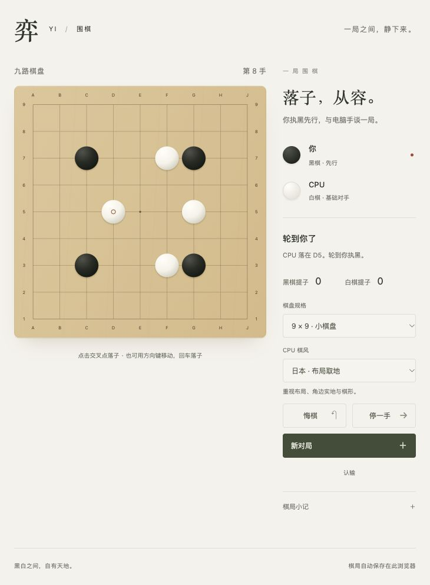

# 弈 · YI

一个用 Go 写的极简围棋应用，也是一个可以从头读完的编程示范项目。

Go 标准库负责规则与 CPU；原生 HTML / CSS / JavaScript 绘制界面。没有第三方 Go 依赖、数据库或前端框架。本地版把页面通过 `go:embed` 编进可执行文件；在线版把同一套 Go 逻辑编译为 WebAssembly，在浏览器中运行。

**[在线下棋 → GitHub Pages](https://lazarus-coder.github.io/yi-go/)**，无需安装 Go，也不需要后台服务。



## 开始一局

需要 **Go 1.24 或更新版本**和现代浏览器。

```sh
git clone https://github.com/Lazarus-coder/yi-go.git
cd yi-go
go run .
```

打开 [http://127.0.0.1:8080](http://127.0.0.1:8080)。默认只监听本机，按 `Ctrl+C` 退出。

```sh
# 构建后可单独分发可执行文件，无需另带 web 目录
go build -o yi-go .
./yi-go

# 换一个本地端口
go run . -addr 127.0.0.1:8081
```

Windows 下可使用 `go build -o yi-go.exe .`，然后运行 `.\yi-go.exe`。构建产物需与目标系统和处理器架构匹配。

你执黑，CPU 执白。支持 9、13、19 路棋盘，点击交叉点落子；也可以聚焦棋盘后用方向键移动，按回车或空格落子。可以停一手、认输、悔棋或开始新局。悔棋撤回最近一轮落子，浏览器自动保存当前棋谱，刷新后继续。

CPU 有三种可选棋风：**中国 · 厚势均衡、日本 · 布局取地、韩国 · 主动攻杀**。可以在对局中切换，从下一次 CPU 应手生效，已有落子保持不变；刷新、悔棋和新对局都会保留棋风选择。它们是供教学比较的游戏化预设，不代表各国所有棋手的风格，也不是棋力等级。

**这是规则与应用设计的教学示例。** CPU 使用基础启发式策略，终局采用简化面积计分，不自动判定死子，适合体验与学习。

## 从哪里读

```text
yi-go/
├── main.go                     本地 HTTP 入口、静态资源嵌入
├── main_test.go                HTTP 校验与恢复、悔棋、认输流程测试
├── cmd/wasm/main.go             浏览器与 Go 之间的 JSON 桥接
├── internal/match/match.go      两种运行方式共用的棋谱重放与完整回合
├── internal/game/
│   ├── game.go                 棋盘、气、提子、简单劫、终局计分
│   ├── cpu.go                  三种棋风的参数、合法候选点与评分
│   ├── game_test.go            规则、基础战术与 CPU 自对弈测试
│   └── style_test.go           风格校验与同局面不同选择
├── web/
│   ├── index.html             页面结构与棋盘 SVG
│   ├── style.css              响应式布局与视觉样式
│   ├── app.js                 棋盘绘制、交互、请求与本地存档
│   ├── engine.js              HTTP / Web Worker 两种调用方式
│   └── engine-worker.js       加载 Go WASM，在后台线程计算
├── scripts/
│   ├── build-pages.sh         生成可部署的 dist/ 静态目录
│   ├── smoke-wasm.mjs         真实 WASM 产物验证
│   └── engine.test.mjs        调用适配与失败恢复测试
├── .github/workflows/test.yml  检查、构建与 Pages 自动发布
├── docs/preview.jpg            界面截图
├── go.mod                     Go 版本与模块声明
└── LICENSE                    MIT 许可证
```

建议按下面的顺序阅读，每一步都能找到对应的可运行行为：

1. [game.go](internal/game/game.go)：先看 `Game` 和 `Play`，理解一手棋怎样改变状态；再看 `groupAt` 与 `tryMove`。
2. [game_test.go](internal/game/game_test.go)：读提子、自杀和打劫的局面测试，把规则对应到具体棋形。
3. [cpu.go](internal/game/cpu.go)：看 CPU 如何复用合法性检查，再给候选落点打分。
4. [match.go](internal/match/match.go)：从 `Run` 走到 `restore`，追踪一轮人类落子与 CPU 应手；再看 [main.go](main.go) 如何接上 HTTP。
5. [app.js](web/app.js)：从 `act`、`request` 到 `draw`，最后看存档恢复和悔棋。
6. [WASM 入口](cmd/wasm/main.go) 与 [engine-worker.js](web/engine-worker.js)：看同一个 `match.Run` 如何搬到浏览器，避免维护两套棋规。

## 一手棋如何成立

棋盘是长度为 `size * size` 的 `[]int`，用 `board[y*size+x]` 访问。`0` 表示空点，`1` 表示黑棋，`2` 表示白棋。

`groupAt` 用洪水填充遍历上下左右相连的同色棋子，同时收集相邻空点。棋子和气分别去重，因此同一个空点即使接触一块棋的多颗棋子，也只算一口气。遍历用切片和循环完成，无需递归。

`tryMove` 按顺序检查，需要试下时使用棋盘副本：

1. 坐标在棋盘内，交叉点没有棋子。
2. 复制棋盘并放下棋子，移除相邻的、已经没有气的对方棋块。
3. 检查新落子的己方棋块是否还有气；没有气则拒绝。
4. 检查新棋盘是否与上一手之前的棋盘相同；相同则触发简单劫。

**先提子、再检查自杀**很关键：吃掉对方棋子可能为自己的棋块腾出气。所有检查通过后，`Play` 才提交新棋盘、更新提子数和棋谱，并交换行棋方；失败时原局面保持不变。CPU 也使用同一个 `tryMove`，不用另写一套规则。

停一手用 `Move{-1, -1}` 表示。连续两次停一手结束对局；正常落子会清零连续停手次数。终局时，`emptyRegions` 再次使用洪水填充，把只接触一种颜色的连通空区计入该方，接触双方或没有接触棋子的空区计为中立。得分是盘面棋子数加这些空点数，白棋另加 `6.5`；提子数只用于展示，不再额外加分。

## CPU 如何选点

[`ChooseMove`](internal/game/cpu.go) 枚举棋盘上的空点，在副本上试下，淘汰非法落点，并使用几条直观规则减少无意义的候选：

- 保护真眼；这里的真眼判断只看相邻棋子与对角保护。
- 通常不填自己的空区，也不侵入不超过 6 点的对方空区；能提子或救出被打吃棋块时例外。
- 不选择落下后只有一口气、同时又没有提子的点。

其余候选按下面的公式评分：

```text
分数 = 100 × 提掉的敌子数
     +  70 × 救出的己子数
     + 棋风的威胁权重 × 受到威胁的敌子数
     + 布局评分
```

“救出”指相邻己方棋块原本只有一口气，落子后合并棋块有多于一口气；“威胁”统计相邻原有两口气的敌方棋块。两者都按棋子数计分，同一棋块不会重复计算。若允许的候选落子后仍只有一口气，再扣除 `30 × 己方新棋块的棋子数`。

布局评分也只是距离运算：距离最近边缘为 `edge`，线位从 `0` 开始；己子、敌子与角部的距离都使用曼哈顿距离。

```text
布局分 = -2 × |edge - 目标线位|
       - 己方距离权重 × |最近己子距离 - 目标己距|
       - 对方距离权重 × |最近敌子距离 - 目标敌距|
       - 角部权重 × 到最近角的距离
```

没有某一颜色的棋子时，跳过对应的距离项。三种参数集中在 `cpuStyles` 表中：

| 预设 / `style` | 威胁权重 | 目标线 | 己距 / 权重 | 敌距 / 权重 | 角部权重 |
| --- | ---: | --- | --- | --- | ---: |
| 中国 / `china` | 12 | 四线（3） | 2 / 2.0 | 3 / 0.8 | 0.08 |
| 日本 / `japan` | 8 | 三线（2） | 4 / 1.2 | 5 / 0.35 | 0.35 |
| 韩国 / `korea` | 20 | 三线（2） | 3 / 1.2 | 1 / 2.8 | 0.08 |

例如，九路空棋盘上黑棋先占天元 `E5`：中国预设应在 `D6`，日本预设应在 `C7`，韩国预设应在 `E6`。这组差异有测试固定，展示厚势、角地和贴身施压如何从参数产生。

最高分胜出；同分时保留从上到下、从左到右遇到的第一个落点。没有候选则停一手。整个策略没有随机数和向后搜索，相同局面会给出相同选择，适合修改权重后比较行为。

## 同一套回合逻辑，两个入口

一次普通落子的路径是：

```text
浏览器交给 HTTP 服务或 Web Worker
  → 提交完整棋谱、棋风与新落点
  → Go 从空棋盘重放、验证历史
  → 应用黑棋落子
  → 若尚未终局，计算并应用 CPU 白棋应手
  → 返回完整局面，浏览器绘制并保存棋谱
```

浏览器的 `localStorage` 只保存棋盘尺寸、棋风、落子历史和认输标记。刷新时用 `sync` 重放；悔棋时截短历史再 `sync`；新对局则提交空历史；切换棋风也用 `sync`，但不改历史。旧存档缺少棋风时，默认使用 `china`。

本地版在 Go HTTP 服务里调用 `match.Run`；Pages 版由 Web Worker 加载 `game.wasm`，经 JSON 桥接调用同一个函数。CPU 计算在 Worker 中执行，避免占用页面主线程。两种方式都从棋谱重建棋盘、提子数与劫状态，不需要会话表或数据库，也不在 JavaScript 中复制棋规。

这个选择把恢复和悔棋统一成了同一件事，也让每次操作都容易单独复现。代价是每次都要传递和计算完整历史，适合本项目的小规模对局。Pages 版落子不依赖 HTTP API；棋谱留在当前浏览器中。存档属于当前浏览器的网站来源，本地版与在线版各自保存；换端口、换浏览器或清理站点数据，都不会沿用原存档。

## 构建与发布 GitHub Pages

```sh
sh scripts/build-pages.sh

# 本地验证静态版本，需要 Python 3；也可换用其他静态文件服务器
python3 -m http.server 8081 --bind 127.0.0.1 --directory dist
```

打开 `http://127.0.0.1:8081/` 即可玩 WASM 版。请通过 HTTP 访问，不要双击 HTML 以 `file://` 打开。

脚本以 `GOOS=js GOARCH=wasm` 编译 `cmd/wasm`，复制与编译器版本匹配的官方 `wasm_exec.js`，并将页面运行模式切换为 `wasm`。`dist/` 不提交到 Git，由 Actions 构建并上传。资源全部使用相对路径，因此能在 `/yi-go/` 这样的项目子路径下运行。

本仓库已使用 **GitHub Actions** 作为 Pages 发布源。Fork 后，在 **Settings → Pages → Build and deployment → Source** 中选择 **GitHub Actions**，再推送 `main` 或手动运行工作流。工作流先跑 Go 测试，再构建和验证真实 WASM，最后发布到 Pages；PR 只执行检查与构建。

## 试一次 API

以下示例适用于本地 Go 服务；Pages 版没有 `/api/game` 服务器接口。服务运行后，下面的请求会使用日本棋风，在空九路棋盘的 `(2, 2)` 落下一颗黑子，并返回 CPU 应手后的局面：

```sh
curl http://127.0.0.1:8080/api/game \
  -H 'Content-Type: application/json' \
  -d '{"size":9,"moves":[],"style":"japan","action":"play","x":2,"y":2}'
```

坐标从左上角 `(0, 0)` 开始，`x` 向右、`y` 向下；例中的落点在界面上是 `C7`。请求始终携带**操作之前**的 `moves` 历史，其中已经包含此前双方的落子。未终局的历史必须包含完整回合，不能缺少 CPU 应手。

| `action` | 行为 |
| --- | --- |
| `sync` | 只重放 `moves`，不调用 CPU；恢复认输局面时附带 `resigned: 1` |
| `play` | 黑棋在 `x`、`y` 落子，未终局时自动接上 CPU 应手 |
| `pass` | 黑棋停一手，未终局时自动接上 CPU 应手 |
| `resign` | 黑棋认输，结束对局 |

`style` 接受 `china`、`japan`、`korea`，缺省为 `china`。成功返回完整 `Game`，包括 `style`、一维 `board`、双方 `moves`、`next`、`lastMove`、`captures`、`passes`、`over`、`resigned` 和终局 `score`。继续下棋时，把响应的 `moves` 和当前 `style` 用于下一次请求；不需要上传 `board`。失败返回相应 HTTP 错误状态和 `{"error":"原因"}`。

## 运行检查

```sh
go test ./...
go vet ./...
go build ./...

# 可选：在支持 race detector 的环境检查数据竞争
go test -race ./...

# 静态版本：需要 Node.js 24 或更新版本，只用内置模块
sh scripts/build-pages.sh
node scripts/smoke-wasm.mjs
node --test scripts/engine.test.mjs
```

规则测试覆盖成块提子、先提子再检查自杀、简单劫、非法落子不改变局面、连续停手、计分和认输。CPU 测试覆盖三种棋风的吃子、救棋、保眼、同局面选择差异，以及三种棋盘上的合法自对弈和终局。HTTP 测试覆盖输入校验、静态页面、对局恢复、悔棋、认输恢复和棋风切换。静态版本还直接加载真实 `game.wasm` 验证调用，并检查 Worker 初始化、超时和失败清理。

## 可以动手改什么

- 改动 `cpuStyles` 中的权重，保留同一份棋谱，比较落点变化；为你希望保留的行为增加一个局面测试。
- 给计分补充一个双方共享空区的测试，观察为什么它不会被计入任何一方。
- 用 API 提交非法落点，检查错误响应；再重放原棋谱，验证局面不变。
- 在现有 `moves` 之上尝试棋谱导出，先约定坐标、停手和认输如何表达。

## 当前边界

- CPU 没有搜索树、难度等级或专业棋力保证；对真眼和空区的判断是局部启发式。
- 采用简单劫，不检测长周期重复局面。
- 面积计分不自动处理死子或复杂双活。停手前需完成必要提子，结果仅作练习参考。
- 应用固定人类执黑、CPU 执白，没有让子、在线对战、账号或云同步。
- 只保存当前一局；新对局会替换存档。HTTP 请求体上限为 64 KiB，输入棋谱最多接受 2000 手。

## 许可

[MIT License](LICENSE)。欢迎阅读、修改和用作教学示例。
