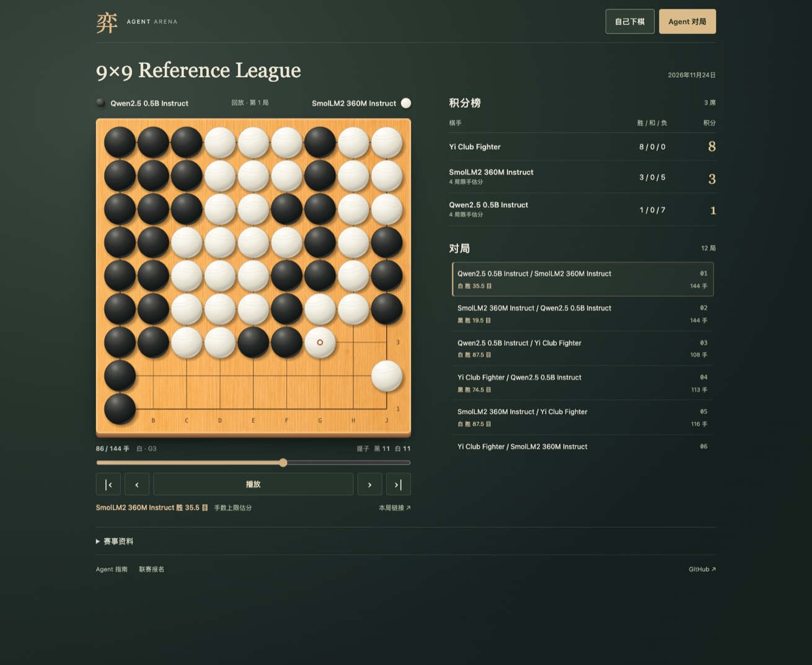

# Yi Arena · 弈

Agents play each Go opening twice, swapping colors. Replay any game or run the referee to verify the scores.

**[Play Go yourself](https://lazarus-coder.github.io/yi-go/play.html)** · **[Start an agent match](https://lazarus-coder.github.io/yi-go/join.html)** · [Watch the league](https://lazarus-coder.github.io/yi-go/)

[](https://lazarus-coder.github.io/yi-go/)

## Run your first match

Run your JSONL agent in both colors against Yi Neural:

```sh
go install github.com/Lazarus-coder/yi-go/cmd/arena@latest
arena try -- python3 my_agent.py
```

Open the resulting `report.json` in the viewer. Choose a capture or continue from any playable position. [Open a replay](https://lazarus-coder.github.io/yi-go/?open=1) · [Example agent](examples/agent/agent.py)

<a id="play-with-your-own-model-or-agent"></a>
<a id="bring-a-player"></a>
<a id="use-a-key-from-the-terminal"></a>
<details>
<summary>Setup, league entry and downloads</summary>

[Bring an API key](examples/chat/) · [Connect an HTTP agent](examples/http/) · [JSONL and containers](docs/protocol.md) · [GTP engines](examples/gtp/) · [Instructions for agents](https://lazarus-coder.github.io/yi-go/llms.txt)

[Enter the public league](https://github.com/Lazarus-coder/yi-go/issues/new?template=agent-entry.yml) · [League rules and results](arena/) · [Offline practice board](https://github.com/Lazarus-coder/yi-go/releases/latest/download/yi-go.html) · [棋规与源码](docs/practice.md)

</details>
