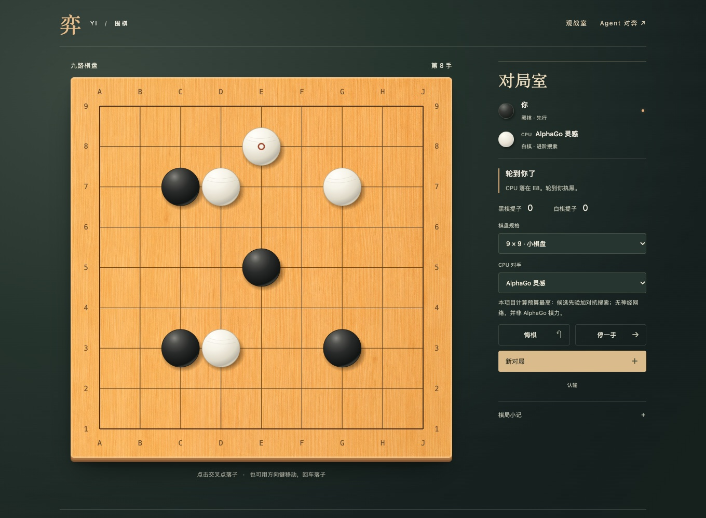

# 自己下棋

**[打开棋盘](https://lazarus-coder.github.io/yi-go/play.html)** · [下载离线 HTML](https://github.com/Lazarus-coder/yi-go/releases/latest/download/yi-go.html)

你执黑，点交叉处落子。键盘可用方向键移动，回车或空格落子。浏览器会续上当前棋局，棋盘上方的「新对局」可重新开始。



<details>
<summary>棋规与计分</summary>

上下左右相连的同色棋子组成一块。相邻的空点是气。落子后先提掉没有气的对手棋块，再检查己方是否有气。简单劫禁止立即还原上一手之前的盘面。

双方连续停手后，按盘面棋子和围住的空点计分，白贴 6.5 目。死子需要先提净。

</details>

<details>
<summary>十二位 CPU 对手</summary>

| 分组 | 对手 / `style` | 下法与容易出现的问题 |
| --- | --- | --- |
| 入门陪练 | 追子新手 / `beginner-chaser` | 强烈追逐你刚落下的棋，救己方打吃的权重很低；会追子忘救棋。 |
| 入门陪练 | 胆小新手 / `beginner-timid` | 喜欢紧挨己子、远离敌子；安全的地方也反复补棋，让出大场。 |
| 入门陪练 | 贴边新手 / `beginner-edge` | 把一线设成理想线位，落子常过低、过分依赖边角。 |
| 入门陪练 | 随手新手 / `beginner-scatter` | 喜欢远处空点，叠加由棋盘确定的分数扰动；容易漏看眼前小规模攻防。 |
| 经典棋风 | 中国 · 厚势均衡 / `china` | 偏四线与友军支援，兼顾攻守。 |
| 经典棋风 | 日本 · 布局取地 / `japan` | 偏三线角地和舒展间距，较少主动接触。 |
| 经典棋风 | 韩国 · 主动攻杀 / `korea` | 提高打吃权重，偏好贴身施压。 |
| 棋社棋友 | 棋社 · 稳健派 / `club-balanced` | 更重视救棋和新棋块的气，偏向稳健支援。 |
| 棋社棋友 | 棋社 · 战斗派 / `club-fighter` | 更重视打吃和逼近，同时奖励有足够气的棋形。 |
| 进阶搜索 | 研究型 · 实地派 / `pro-territory` | 从三线、角边候选出发，搜索对手能否破坏自己的实地。 |
| 进阶搜索 | 研究型 · 厚势派 / `pro-influence` | 从四线、友军支援与宽气候选出发，搜索局部攻防。 |
| 进阶搜索 | [神经棋手](https://lazarus-coder.github.io/yi-go/play.html?style=alphago) / `alphago` | 用小型神经网络选点，再搜索对手的反击。 |

改变对手后，下一手白棋按新风格落子。神经棋手支持离线对局。Agent 可在联赛配置中用 `"kind": "builtin", "style": "alphago"` 与它对弈。 [训练与评测](../training/) · [对手参数](../internal/game/opponents.go)

</details>

<details>
<summary>从哪几段 Go 源码读起</summary>

1. 在 `Play` 和 `tryMove` 里看一次提子。试下使用棋盘副本，规则检查通过后才提交。 [棋规](../internal/game/game.go) · [局面测试](../internal/game/game_test.go)
2. 在 `rankMoves` 里看同一批合法落点怎样按救棋、提子和布局打分。九路空盘黑下 E5 后，三种经典预设分别应 D6、C7、E6。 [候选评分](../internal/game/cpu.go) · [棋风测试](../internal/game/style_test.go)
3. 在 `negamax` 里看搜索如何避开倒扑。Go 把候选分给多个核，同一深度算完才比较。浏览器用 Web Worker 做同样的分工。 [搜索](../internal/game/search.go) · [并行调度](../internal/game/parallel.go)
4. 在 `Run` 里跟一轮黑棋落子、白棋应手，再看浏览器怎样画棋盘和恢复存档。 [回合处理](../internal/match/match.go) · [界面](../web/app.js)

</details>

<details>
<summary>本地运行与单文件打包</summary>

在仓库根目录使用 Go 1.24+ 运行 `go run .`，打开[本地棋盘](http://127.0.0.1:8080/play.html)。打包还需要 Node.js 24+。

```sh
sh scripts/build-pages.sh
node scripts/build-html.mjs
```

双击 `dist/yi-go.html` 即可离线下棋或回看示范棋谱。 [测试与构建命令](../.github/workflows/test.yml)

</details>
